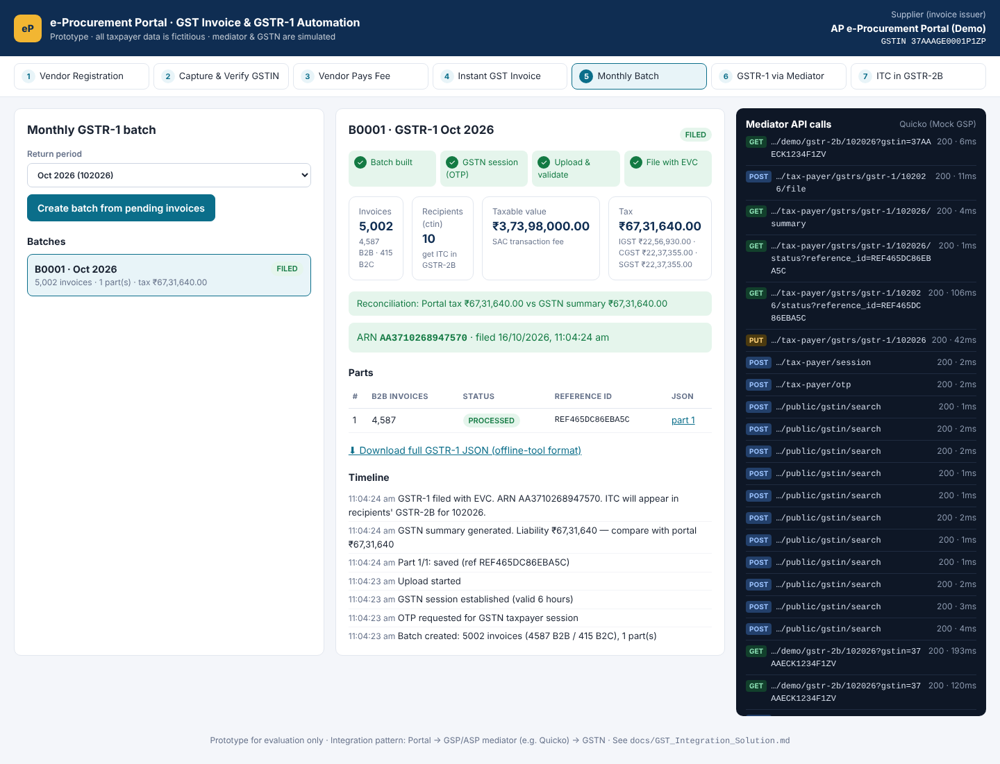
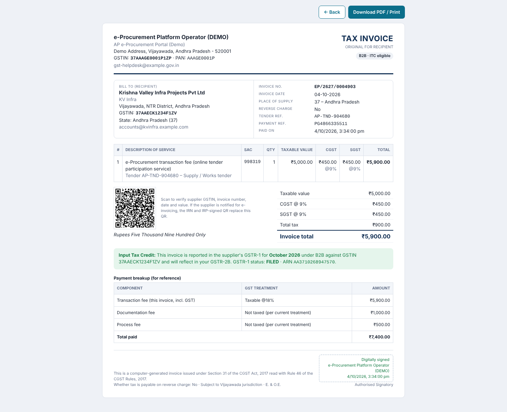
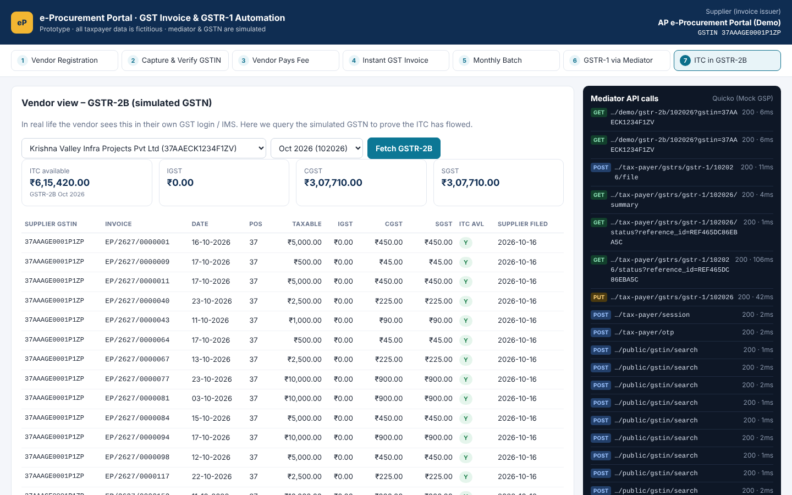

# e-Procurement GST Invoice & GSTR-1 Automation — Prototype

Registered vendors pay **18% GST on the transaction fee** on the e-Procurement portal, but today those payments are filed in GSTR-1 as supplies to *unregistered persons* (B2CS), so the vendors **cannot claim Input Tax Credit**.

This prototype shows the fix end-to-end:

```
Vendor Registration → Capture GSTIN → Verify GSTIN (mediator API) → Vendor pays fee
→ Instant GST tax invoice → Stored in DB → Monthly / daily GSTR-1 batch
→ Mediator (GSP/ASP e.g. Quicko) GSTR-1 API → GSTN → Vendor gets ITC in GSTR-2B
```

📄 **Full solution document:** [`docs/GST_Integration_Solution.md`](docs/GST_Integration_Solution.md) — problem analysis, legal basis, 5 solution options, vendor landscape (1 GSP vendor needed), Zomato/Uber-style instant invoice benchmark, Rule 46 invoice checklist, API contract, 1.5 lakh/month volume design, SQL Server data model, exception handling, past-period remediation (deadline 30 Nov 2026), security and implementation plan.

🧩 **.NET reference client:** [`docs/dotnet/GstMediatorClient.cs`](docs/dotnet/GstMediatorClient.cs) — drop-in `HttpClient` adapter, GSTIN check-digit validation and chunked GSTR-1 filing workflow for the existing .NET portal.

## Run it

Requires Node.js 18+ only (no `npm install`, no database).

```bash
node server.js          # http://localhost:4000
```

Demo OTP for the simulated GSTN: **575757**

Quick tour:
1. **Capture & Verify GSTIN** → *Load sample vendors* (or type a GSTIN — the check digit is validated as you type).
2. **Vendor Pays Fee** → pay a fee; the tax invoice opens instantly (print / save as PDF, with QR).
3. **Bulk simulation** → generate 5,000 … 1,50,000 payments for the month.
4. **Monthly Batch** → create batch → *Send OTP* → *Connect* → *Upload & validate* → *File GSTR-1* → ARN.
5. **ITC in GSTR-2B** → choose a vendor and see the credit that now flows to them.

The dark panel on the right shows every request/response exchanged with the mediator.

### Automated check

```bash
node server.js &
npm test                       # full flow with 3,000 invoices
node scripts/e2e.js 150000     # volume test: 1.5 lakh invoices in one month
```

## Screenshots

| Monthly GSTR-1 filing (1.5 lakh invoices, 28 parts) | Instant tax invoice |
|---|---|
|  |  |
| **Fee payment with live tax preview** | **Vendor GSTR-2B (ITC available)** |
|  |  |

## Project layout

```
server.js                 HTTP server, REST API, filing workflow
src/config.js             supplier, fee components, SAC, mediator settings
src/gstin.js              GSTIN format + mod-36 check digit, state codes
src/invoice.js            invoice numbering (≤16 chars / FY), CGST+SGST vs IGST, amount in words
src/gstr1.js              GSTR-1 JSON (b2b, b2cs, hsn_b2b/hsn_b2c, doc_issue) + chunking
src/mediatorClient.js     adapter to the GSP/ASP — the only file that changes per provider
mock/quickoMock.js        simulated mediator + GSTN (GSTIN search, OTP, save/status/summary/file, GSTR-2B)
public/                   web UI (vanilla JS) and printable invoice
docs/                     solution document, .NET client, screenshots
```

## Connecting a real mediator

Set environment variables and align the endpoint paths in `src/mediatorClient.js` with the provider's API reference:

| Variable | Purpose |
|---|---|
| `MEDIATOR_BASE_URL` | Provider base URL (unset = built-in mock) |
| `MEDIATOR_API_KEY`, `MEDIATOR_API_SECRET` | Provider credentials |
| `MEDIATOR_NAME` | Display name |
| `SUPPLIER_GSTIN`, `SUPPLIER_NAME`, `GST_USERNAME` | Supplier (invoice issuer) details |
| `SAC_CODE` | SAC for the transaction fee (confirm with the tax advisor) |
| `GSTR1_CHUNK_SIZE` | Invoices per save call (default 5000) |

> All taxpayer names, GSTINs and amounts in this prototype are fictitious. The mediator and GSTN are simulated.
