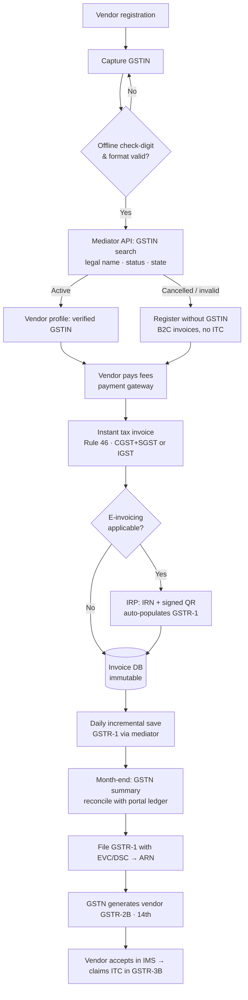
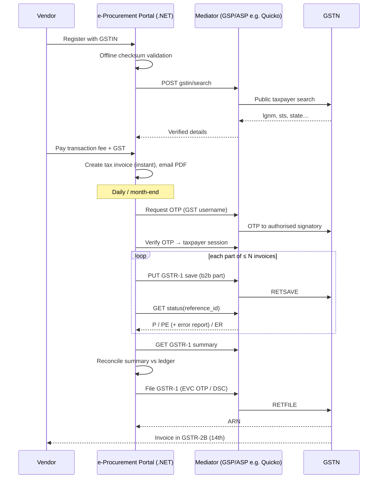

# GST Invoicing & Automated GSTR-1 Filing for e-Procurement Transaction Fees

**Solution document and prototype guide**
Prepared by: Rakeshkumar-369 · Version 1.0 · October 2026

> **Scope.** This document covers the e-Procurement portal of the Government of Andhra Pradesh, where vendors pay fees to take part in tenders. It explains how GST charged on the **transaction fee** can be passed to vendors as **Input Tax Credit (ITC)**. To do that, every payment gets a GST-compliant B2B tax invoice and the invoices are filed automatically in **GSTR-1** through a GST mediator (GSP/ASP such as Quicko). A working prototype is in this repository (`npm start`).
>
> *The legal points below summarise the CGST Act/Rules as generally understood. The finance team and a Chartered Accountant must confirm them before go-live, especially the items marked **[CA]**.*

---

## Table of contents

1. [Executive summary](#1-executive-summary)
2. [Problem statement and root cause](#2-problem-statement-and-root-cause)
3. [Legal and regulatory basis](#3-legal-and-regulatory-basis)
4. [Target process (improved flow)](#4-target-process-improved-flow)
5. [Solution options: 5 approaches](#5-solution-options--5-approaches)
6. [Vendors / service providers and how many are needed](#6-vendors--service-providers-and-how-many-are-needed)
7. [Instant GST invoice: benchmark (Zomato, Uber, Swiggy, Amazon Business, airlines)](#7-instant-gst-invoice--benchmark)
8. [Mandatory invoice content (Rule 46) and invoice design](#8-mandatory-invoice-content-rule-46-and-invoice-design)
9. [Integration design: portal ⇄ mediator ⇄ GSTN](#9-integration-design--portal--mediator--gstn)
10. [Handling 1.5 lakh+ invoices a month](#10-handling-15-lakh-invoices-a-month)
11. [Data model (SQL Server, for the existing .NET portal)](#11-data-model-sql-server)
12. [Exceptions, corrections and reconciliation](#12-exceptions-corrections-and-reconciliation)
13. [Past periods: passing ITC already lost (time-critical)](#13-past-periods--passing-itc-already-lost-time-critical)
14. [Security, compliance and audit](#14-security-compliance-and-audit)
15. [Implementation plan](#15-implementation-plan)
16. [Prototype: what it demonstrates and how to run it](#16-prototype--what-it-demonstrates-and-how-to-run-it)
17. [Open questions for the finance team / CA](#17-open-questions-for-the-finance-team--ca)
18. [References](#18-references)

---

## 1. Executive summary

| | |
|---|---|
| **Problem** | GST at 18% is collected on the transaction fee, but every payment is reported in GSTR-1 as a supply to **unregistered persons (B2CS)**. Registered vendors therefore never see the credit in **GSTR-2B** and lose the ITC, even though they paid the GST. |
| **Volume** | About **1,50,000+** fee transactions a month, which is too many to file by hand. |
| **Fix** | (1) Capture and **verify the vendor GSTIN** once, at registration. (2) Issue an **instant B2B tax invoice** for each transaction-fee payment. (3) Run a **monthly (better: daily) automated GSTR-1 upload** through a GSP/ASP API (Quicko or similar). The vendor then gets the ITC in GSTR-2B. |
| **Vendors needed** | **One** GSP/ASP provider is enough end-to-end (GSTIN verification + GSTR-1 save/file, and e-invoice/IRN if applicable). Nothing else is needed: the payment gateway and the portal stay as they are. |
| **Recommended option** | **Option A (GSP API automation)**, combined with **Option B (e-invoicing via IRP)** if the supplier's turnover makes e-invoicing mandatory. Keep Option C (JSON + offline tool) as the fallback/BCP. |
| **Urgent** | Invoices of **FY 2025-26** wrongly reported as B2C can, in general, still be corrected only **up to 30 November 2026** (Sec 37(3) and Sec 16(4)). After that the vendors' ITC is lost for good. See §13. **[CA]** |
| **Prototype** | Node.js demo (no dependencies) covering the whole flow: GSTIN verification → instant invoice (PDF/print with QR) → monthly batch → OTP session → chunked upload → GSTN summary reconciliation → EVC filing → ARN → vendor GSTR-2B. Tested with **1,50,002 invoices in one month** (28 parts, filed end-to-end). |

---

## 2. Problem statement and root cause

**What the vendor pays.** The vendor pays up to four components:

| Component | GST today | Comment |
|---|---|---|
| Transaction fee | **18% GST** | Consideration for the e-procurement service, so it is a taxable supply |
| Corpus fund | None | Not a supply / pass-through |
| Documentation fee | None (as per current treatment) **[CA]** | Confirm the classification |
| Process fee | None (as per current treatment) **[CA]** | Confirm the classification |

**What happens today:**

```
Vendor pays fee + GST  ──►  Portal books revenue  ──►  GSTR-1: Table 7 (B2CS, consolidated, no GSTIN)
                                                                      │
                                                                      ▼
                                              Vendor's GSTR-2B: nothing  ──►  ITC lost
```

**Root cause.** Under **Section 16(2)(aa)** of the CGST Act, read with **Rule 36(4)**, a recipient may claim ITC only if the supplier has reported the invoice **against the recipient's GSTIN** in GSTR-1 and it appears in the recipient's **GSTR-2B**. B2CS rows carry no recipient GSTIN, so nothing flows to the vendor. The tax is paid to the Government either way. The only thing missing is **reporting the invoice against the vendor's GSTIN**.

**Why it has not been done so far.** At 1.5 lakh+ transactions a month, manual GSTR-1 data entry is not practical. The fix therefore has to be **system-to-system**: e-Procurement portal → GSP/ASP API → GSTN.

---

## 3. Legal and regulatory basis

| Provision | What it means for this project |
|---|---|
| **Sec 31 CGST Act + Rule 47** | A tax invoice for services must be issued **within 30 days** of supply. Issuing it instantly at payment (the Uber/Zomato pattern) is compliant and simplest. |
| **Rule 46** | Lists the mandatory invoice fields (see §8): a serial number of **max 16 characters, unique per financial year**, recipient GSTIN, place of supply, SAC, tax split, signature/digital signature, and so on. |
| **Sec 12(2)(a) IGST Act** | Place of supply for B2B services is the **location of the registered recipient** (the state code in the vendor's GSTIN). If it is the same state as the supplier (AP, code 37), charge CGST 9% + SGST 9%. Otherwise charge **IGST 18%**. *The prototype implements this automatically.* |
| **Sec 37 + Rule 59** | GSTR-1 is due by the **11th** of the next month for monthly filers. B2B invoices go to **Table 4A**, invoice by invoice. B2C (intra-state, or inter-state ≤ the B2CL threshold) goes to **Table 7** (consolidated). Table 12 is the HSN/SAC summary (split into B2B / B2C) and Table 13 lists the documents issued. |
| **Sec 16(2)(aa), Rule 36(4)** | The recipient's ITC is limited to invoices in **GSTR-2B**. GSTR-2B is generated on the **14th** of the following month. |
| **Invoice Management System (IMS)** (from Oct 2024) | Recipients can **accept / reject / keep pending** each inward invoice before GSTR-2B is finalised. Expect rejections (wrong GSTIN, etc.) and handle them (§12). |
| **GSTR-1A** | Lets the supplier add or amend records of the same tax period after filing GSTR-1 and before filing GSTR-3B. This is a useful safety valve. |
| **Sec 37(3) proviso / Sec 16(4)** | Errors in GSTR-1 can be corrected, and the recipient can claim ITC, up to **30 November following the end of the financial year** (or the annual return date, if earlier). |
| **Rule 48(4): e-invoicing** | Mandatory for B2B invoices if the supplier's **aggregate turnover in any FY from 2017-18 exceeds ₹5 crore**. **Government departments and local authorities are exempt**, but a Government **company / corporation / society** is **not**. If e-invoicing applies, each B2B invoice must get an **IRN + signed QR from the IRP**. IRP data **auto-populates GSTR-1**. If AATO ≥ ₹10 crore, invoices must be reported to the IRP **within 30 days** of the invoice date. **[CA]** |
| **Notification 13/2017-CT(Rate), entry 5** | If the supplier were a **Government department** itself, services to a business entity could fall under **reverse charge**, with no GST charged on the invoice. This document assumes the fee is collected by a **GST-registered entity charging GST under forward charge** (as is done today). **[CA]** |

---

## 4. Target process (improved flow)

The flow you shared is correct. The improvements below make it faster to operate and safer at 1.5 lakh+ invoices a month:

| # | Your flow | Improvement |
|---|---|---|
| 1 | Vendor registration | Unchanged. Make the GSTIN field prominent with the help text *"Provide GSTIN to receive ITC"* (like Uber/Zomato's "Add GST details"). |
| 2 | Capture GSTIN | **Validate the format and check digit offline first** (free, instant, catches typos) before any API call. |
| 3 | Verify GSTIN via Quicko | Store the **GSTN legal name, status and state** from the response. Use the GSTN legal name on the invoice. **Re-verify monthly** (or before each batch) to catch cancelled or suspended GSTINs. |
| 4 | Vendor pays fee | Unchanged. Allow the vendor to choose *which* of their GSTINs (if they have several states) at payment time. |
| 5 | Generate GST invoice | Generate **synchronously at payment success**. Email the PDF and keep it downloadable in the vendor dashboard. If e-invoicing applies, get the **IRN/QR** in the same step (or asynchronously within 30 days). |
| 6 | Store invoice in DB | Store it **immutably**: invoices are never edited, only corrected via credit notes / amendments. |
| 7 | Monthly batch creation | **Upload daily (incremental save)** instead of once a month. GSTN lets you *save* GSTR-1 data throughout the month, so the month-end becomes "review summary + file", not "upload 1.5 lakh invoices under deadline pressure". |
| 8 | Quicko GSTR-1 API | Save in **chunks** (for example 5,000 invoices), poll the status per reference ID, read the **error report**, and **resume** only the failed parts. |
| 9 | GSTN | **Reconcile** the GSTN-generated summary against the portal ledger **before** filing with EVC/DSC. Store the ARN. |
| 10 | Vendor gets ITC in GSTR-2B | Show the **"Reported in GSTR-1 – ARN …"** status on each invoice in the vendor dashboard. This sharply reduces helpdesk calls. |

### Improved end-to-end flow



### Sequence (who calls whom)



**Process size.** 10 steps, 3 actors (vendor, portal, finance user), 2 external systems (mediator, GSTN), and **1 human touch-point per month**: OTP/EVC approval by the authorised signatory.

---

## 5. Solution options: 5 approaches

### Option A: GSP/ASP API integration (Quicko or similar) ★ Recommended

The portal calls a GST Suvidha Provider (GSP) or an Application Service Provider (ASP) over REST. The provider talks to GSTN.

* **How:** GSTIN search API at registration. Taxpayer session (OTP) → GSTR-1 **save** (chunks) → **status** → **summary** → **file** (EVC/DSC).
* **Pros:** Fully automated. Scales to lakhs of invoices. Error reports per invoice. The same provider usually also offers e-invoice (IRN), GSTR-2B and IMS APIs. Go-live in weeks.
* **Cons:** Recurring cost (per GSTIN / per API call / per invoice slab). Dependence on one provider (mitigate with an adapter layer: the prototype's `mediatorClient` is exactly that).
* **Prerequisite:** "Enable API access" must be switched on in the supplier's GST portal profile (*My Profile → Manage API Access*), and the authorised signatory must receive the OTPs.

### Option B: E-invoicing via the IRP (auto-population of GSTR-1)

Each B2B invoice is reported to an **Invoice Registration Portal (IRP)**. The IRP returns an **IRN + signed QR** and **pushes the invoice to GSTN**, where it **auto-populates Table 4A of GSTR-1**.

* **When:** Mandatory if the supplier's AATO exceeded ₹5 crore in any FY since 2017-18 (Government departments are exempt; companies/corporations are not). **[CA]** It can also be adopted voluntarily where allowed.
* **Pros:** Removes the B2B part of the GSTR-1 upload entirely. Invoices are legally authenticated (IRN). The same data flows to the vendor's GSTR-2B.
* **Cons:** One IRP API call per invoice (~5,000/day, which is fine). B2CS, HSN and document summary still have to be furnished, and GSTR-1 still has to be filed.
* **Access:** Through the same GSP (most provide IRP APIs), or directly from an IRP (NIC IRP / private IRPs such as Clear, Cygnet, IRIS, EY) when the API-access eligibility criteria are met.

### Option C: Bulk JSON generation + GST Offline Tool / portal upload (no third party)

The portal generates the GSTR-1 **JSON in GSTN's offline-tool format** (the prototype already does this: *Download full GSTR-1 JSON*). The finance user uploads it on gst.gov.in (Returns → GSTR-1 → Prepare Offline → Upload).

* **Pros:** No vendor contract and no API cost. Good as a **fallback / BCP** if the GSP is down near the due date.
* **Cons:** Manual monthly work. File-size limits mean several uploads (1.5 lakh invoices → many files). Error files have to be downloaded and fixed by hand. Not "automation" in the strict sense.

### Option D: Direct GSTN API access (become an ASP of a GSP, or obtain direct access)

GSTN gives API access mainly through licensed **GSPs**. A large organisation can (i) become a GSP itself (heavy: application to GSTN, infrastructure, security audit) or (ii) use **direct ERP-to-GSTN access** for large taxpayers where GSTN offers it.

* **Pros:** No per-transaction fee to an intermediary. Full control.
* **Cons:** Long approval cycle, security audit, own maintenance of every GSTN API version change. Not justified for one GSTIN.
* **Use:** Long-term option only, if APTS / the State runs many GST-registered entities.

### Option E: Process change: one consolidated monthly invoice per vendor (combine with A/B/C)

Instead of one invoice per payment, issue **one tax invoice per vendor GSTIN per month** listing all transaction fees of that month as line items, issued within the time permitted by Rule 47. **[CA]**

* **Effect:** 1.5 lakh invoices → the number of **distinct vendors per month** (maybe 10–20 thousand). Fewer invoices also means fewer IRNs if e-invoicing applies.
* **Pros:** Much lower volume and API cost.
* **Cons:** The vendor does not get an "instant" invoice per payment (they get a payment receipt instead). Legally the timing must be within 30 days of *each* supply, so the consolidation window must be confirmed by the CA.
* **Recommendation:** Keep **instant invoices** (better vendor experience, mirrors Uber/Zomato). Volume is not a real problem with Option A + daily saves (the prototype files 1.5 lakh invoices in minutes against the mock).

### Comparison

| Criterion | A. GSP API | B. E-invoice (IRP) | C. JSON + offline tool | D. Direct GSTN | E. Consolidated invoice |
|---|---|---|---|---|---|
| Automation level | Full | Full (B2B) | Partial (manual upload) | Full | Process change only |
| Third party needed | 1 GSP/ASP | IRP (via GSP or direct) | None | None (but GSTN approval) | n/a |
| Time to go live | 4–8 weeks | 4–8 weeks | 2–3 weeks | 6–12+ months | Policy decision |
| Handles 1.5 lakh/month | ✅ | ✅ | ⚠ many files | ✅ | Reduces volume |
| Cost | API subscription | API subscription | Staff time | Infra + audit | — |
| Vendor experience | Instant invoice + ITC | Instant invoice with IRN + ITC | ITC (delayed if upload misses due date) | Same as A | Monthly invoice |
| Recommended | **Primary** | **If e-invoicing applies** | **Fallback / BCP** | Not now | Not needed |

---

## 6. Vendors / service providers and how many are needed

**How many vendors are required? → One.** A single GSP/ASP covers:

1. GSTIN verification (public search API).
2. GSTR-1 save / status / summary / file.
3. (If applicable) e-invoice IRN generation through the IRP.
4. (Optional) GSTR-2B / IMS, and reconciliation APIs for the supplier's own purchases.

The existing **payment gateway** and **e-Procurement portal** stay as they are. **A second provider is optional**, as a warm standby for business continuity. The adapter layer (`IGstMediator` in the .NET sample) lets you switch providers through configuration.

### Market landscape (shortlist for RFP)

| Provider | Type | Typical strengths | Notes |
|---|---|---|---|
| **Quicko: Sandbox APIs** (developer.sandbox.co.in) | API platform (developer-first) | Clean REST APIs for GSTIN search, GST returns, test sandbox, quick onboarding | Named in the brief. Confirm the current GSTR-1 endpoints and volume pricing. |
| **Clear (ClearTax)** | Licensed GSP + private IRP | Enterprise-scale GSTR-1, e-invoice, IMS, large-volume batch APIs | Widely used by large taxpayers |
| **Masters India** | Licensed GSP | E-invoice / e-way bill / returns APIs, strong in high-volume integrations | |
| **IRIS GST (IRIS Business Services)** | Licensed GSP + private IRP | Returns APIs, IRP (IRIS IRP), reconciliation | Publishes the save-API limits in its KB |
| **Cygnet Infotech (Cygnet GSP)** | Licensed GSP + private IRP | E-invoice, returns, ERP connectors | |
| **Vayana Network** | Licensed GSP | Public GSP API docs (GSTR-1 save v2.x), developer portal | Good reference for raw GSTN API shapes |
| **Adaequare, Webtel, TaxPro and others** | Licensed GSPs | Returns and e-invoice APIs | Check the current list on GSTN's GSP page |

> Check every provider against the **current list of GSPs on gstn.org.in** and the **list of IRPs on einvoice.gst.gov.in** at the time of the RFP. Provider capabilities and prices change.

### RFP / evaluation checklist

* GSTR-1 **save in chunks** with an async reference ID, **per-invoice error report**, and summary + **EVC & DSC filing** APIs.
* Throughput: ≥ 1.5 lakh invoices/month, ≥ 10,000 invoices/day sustained, SLA ≥ 99.5%, support during the 1st–11th of each month.
* GSTIN search API (bulk, if available) and **e-invoice (IRN)** API.
* Sandbox environment with test GSTINs. Idempotency (re-sending the same invoice number must upsert, not duplicate).
* Data residency in India, ISO 27001 / SOC 2, CERT-In empanelled audit report, data deletion policy, MeitY guidelines.
* Pricing model (per GSTIN / per invoice slab / per API call) for **1.5–2 lakh invoices/month** and **~20–30 thousand GSTIN verifications/month**.
* Exit clause: data export and handover of saved/filed status.

---

## 7. Instant GST invoice: benchmark

The "instant GST invoice" that consumer platforms give business users is exactly the experience to copy. Common practices seen across these platforms:

| Platform | How the business user gets a GST invoice | What we adopt |
|---|---|---|
| **Uber (Uber for Business)** | The GSTIN is added in the business profile once. After every trip, an **invoice is emailed instantly** and is downloadable from the trip history. **Separate invoices** are issued for different suppliers (e.g. the ride vs. the platform/convenience fee). | GSTIN captured once at registration; one invoice per payment; email + dashboard download. |
| **Zomato / Swiggy** | **"Add GST details"** at checkout (GSTIN + business name) makes the bill a B2B invoice. The platform's own fees (platform/delivery fee) are invoiced **separately** from the food supply (which the platform pays under Sec 9(5) as an e-commerce operator). Invoices are in Order history as PDFs. | Invoice only the taxable component (transaction fee). Non-taxable fees go in a separate receipt/breakup. |
| **Amazon Business** | A GST invoice with the buyer GSTIN for "business purchases", promoted as *"claim input tax credit"*. The invoice is downloadable per order. | An ITC message on the invoice and the vendor dashboard. |
| **Airlines (IndiGo, Air India…)** | The GSTIN is entered at booking. The **GST invoice is emailed** and can be retrieved later from a "GST invoice" page using PNR + email. | A self-service **"Download GST invoice"** lookup by payment/tender reference. |
| **Common elements** | Generated at payment success · unique serial per GSTIN per FY · supplier + recipient GSTIN · SAC/HSN · place of supply · CGST/SGST or IGST · QR code (IRN QR where e-invoiced) · digitally signed PDF · emailed + downloadable · reported in GSTR-1 against the recipient GSTIN so it shows in GSTR-2B | **All implemented in the prototype** (IRN shown as a placeholder note; it is added when Option B applies). |

**Vendor experience target:** *Pay fee → in under 5 seconds: a tax invoice PDF in the inbox and in the dashboard → by the 14th of next month: credit visible in GSTR-2B → the invoice shows "Reported in GSTR-1 · ARN …".*

---

## 8. Mandatory invoice content (Rule 46) and invoice design

| # | Rule 46 requirement | Value used in the prototype |
|---|---|---|
| a | Supplier name, address, GSTIN | From configuration (operator entity, AP – 37) |
| b | Consecutive serial number, ≤ 16 chars, unique per FY | `EP/2627/0000001` (15 chars), series reset per FY |
| c | Date of issue | Payment success timestamp |
| d | Recipient name, address, GSTIN (if registered) | **GSTN legal name** from verification |
| e | Recipient name/address + state (unregistered, where required) | Vendor profile address/state |
| f | HSN/SAC | SAC configurable (placeholder `998319`, **confirm with CA [CA]**) |
| g | Description of service | "e-Procurement transaction fee (online tender participation service)" + tender ref |
| h | Quantity | 1 (NA unit) |
| i | Total value | Transaction fee + GST |
| j | Taxable value (net of discount) | Transaction fee |
| k | Rate of tax | 18% (9% + 9% or 18% IGST) |
| l | Amount of tax (CGST/SGST/IGST/cess) | Computed, rounded to paise |
| m | Place of supply + state name | Recipient GSTIN state (Sec 12(2)(a) IGST) |
| o | Whether tax is payable on reverse charge | "No" |
| q | Signature / **digital signature** | Digitally signed PDF in production (DSC/e-sign of the authorised signatory). The prototype shows a placeholder. |
| — | QR code | Invoice summary QR. **IRN + IRP-signed QR** if e-invoicing applies. |
| — | Extra (good practice) | Payment reference, tender ID, payment breakup of non-taxable fees, amount in words, GSTR-1 status + ARN, ITC note |

Open the prototype and click **Invoices → View** to see the layout (print → "Save as PDF").

---

## 9. Integration design: portal ⇄ mediator ⇄ GSTN

### Components (fitting the existing .NET portal)

```
┌─────────────────────────── e-Procurement portal (.NET) ───────────────────────────┐
│ Vendor module ──► GstinService ──┐                                                  │
│ Payment module ──► InvoiceService ──► InvoicePdfService (DSC) ──► Email/SMS          │
│                                  │                                                  │
│ Background jobs (Hangfire / Quartz / Windows Service):                              │
│   • DailyGstr1SaveJob   (saves yesterday's invoices, chunked, resumable)            │
│   • MonthEndFilingJob   (summary → reconcile → notify signatory for EVC)            │
│   • GstinReverifyJob    (monthly)                                                   │
│                                  ▼                                                  │
│                      IGstMediator  (adapter; Quicko / Clear / Masters… impl.)       │
└──────────────────────────────────┬─────────────────────────────────────────────────┘
                                   │ HTTPS + API key/secret + taxpayer session token
                                   ▼
                     GSP / ASP (e.g. Quicko)  ──►  GSTN (and IRP if e-invoicing)
```

A ready-to-adapt C# client is in [`docs/dotnet/GstMediatorClient.cs`](dotnet/GstMediatorClient.cs).

### API contract used by the prototype (mirrors typical GSP APIs)

| Step | Call | Request (key fields) | Response |
|---|---|---|---|
| 0 | `POST /authenticate` | headers `x-api-key`, `x-api-secret` | `access_token` (24h) |
| 1 | `POST /gst/compliance/public/gstin/search` | `{ "gstin": "37AAECK1234F1ZV" }` | `lgnm, tradeNam, sts, ctb, rgdt, dty, stj, pradr` |
| 2 | `POST /gst/compliance/tax-payer/otp` | `{ gstin, username }` | OTP sent to the authorised signatory |
| 3 | `POST /gst/compliance/tax-payer/session` | `{ gstin, username, otp }` | `taxpayer_token` (≈6h) |
| 4 | `PUT /gst/compliance/tax-payer/gstrs/gstr-1/{MMYYYY}` | GSTR-1 part: `{ gstin, fp, b2b:[{ctin, inv:[…]}], b2cs, hsn, doc_issue }` | `reference_id` |
| 5 | `GET …/gstr-1/{MMYYYY}/status?reference_id=` | — | `status_cd`: `IP` in progress · `P` processed · `PE` processed with errors (+`error_report`) · `ER` error |
| 6 | `GET …/gstr-1/{MMYYYY}/summary` | — | section totals + `summary_hash` |
| 7 | `POST …/gstr-1/{MMYYYY}/file` | `{ otp (EVC), summary_hash }` | `arn` |

> Endpoint paths follow the style of Quicko's Sandbox GST APIs and other GSPs. **Each provider names them differently: confirm against the chosen provider's API reference.** Only the adapter changes; the rest of the portal does not.

### GSTR-1 B2B payload (one invoice), GSTN format

```json
{
  "gstin": "37AAAGE0001P1ZP",
  "fp": "102026",
  "b2b": [{
    "ctin": "36AAJCD8642H1ZD",
    "inv": [{
      "inum": "EP/2627/0000002", "idt": "16-10-2026", "val": 11800,
      "pos": "36", "rchrg": "N", "inv_typ": "R",
      "itms": [{ "num": 1801, "itm_det": { "txval": 10000, "rt": 18, "iamt": 1800, "camt": 0, "samt": 0, "csamt": 0 } }]
    }]
  }],
  "b2cs": [{ "sply_ty": "INTRA", "pos": "37", "typ": "OE", "rt": 18, "txval": 25000, "iamt": 0, "camt": 2250, "samt": 2250, "csamt": 0 }],
  "hsn": { "hsn_b2b": [ { "num": 1, "hsn_sc": "998319", "uqc": "NA", "qty": 0, "rt": 18, "txval": 10000, "iamt": 1800, "camt": 0, "samt": 0, "csamt": 0 } ], "hsn_b2c": [] },
  "doc_issue": { "doc_det": [{ "doc_num": 1, "docs": [{ "num": 1, "from": "EP/2627/0000001", "to": "EP/2627/0000002", "totnum": 2, "cancel": 0, "net_issue": 2 }] }] }
}
```

---

## 10. Handling 1.5 lakh+ invoices a month

| Concern | Design |
|---|---|
| **Size per save call** | GSPs report an upper limit of roughly **30,000 invoices per GSTN save request**. Use **≤ 5,000 per part** (configurable `GSTR1_CHUNK_SIZE`): faster processing, smaller error reports, cheaper retries. 1.5 lakh → ~30 parts. |
| **Spread the load** | **Daily incremental saves** (~5,000 invoices/day). Save is an *upsert by invoice number*, so re-sending is harmless. Month-end only does summary + file. |
| **Async processing** | Every save returns a `reference_id`. Poll the status (back-off 2s → 30s). Never send the next part for the same section before the previous one is processed. |
| **Idempotency / resume** | Track a status per part (`PENDING → SAVING → PROCESSED / PROCESSED_WITH_ERRORS / FAILED`). On a restart, skip processed parts (implemented in the prototype). |
| **Session expiry** | The taxpayer session lasts ~6 hours. Re-request the OTP when a call returns 401. API access validity is set in the GST portal (*Manage API Access*), up to 30 days. |
| **Deadline** | Due date: **11th**. Target: all data saved by the **3rd**, summary reconciled by the **5th**, filed by the **7th**. |
| **Reconciliation gate** | The GSTN summary (tax liability) must equal the portal ledger to the rupee before the **File** button is enabled. The prototype shows this check. |
| **Performance (prototype)** | 1,50,002 invoices: generation ~1.6 s, batch build + 28-part upload + summary + file against the mock in ~1.5 min on a laptop-class container. |

---

## 11. Data model (SQL Server)

```sql
-- Vendor GSTIN (one vendor may hold several GSTINs, one per state)
CREATE TABLE VendorGstin (
  VendorGstinId      BIGINT IDENTITY PRIMARY KEY,
  VendorId           BIGINT NOT NULL,
  Gstin              CHAR(15) NOT NULL UNIQUE,
  LegalName          NVARCHAR(200) NOT NULL,     -- from GSTN
  TradeName          NVARCHAR(200) NULL,
  StateCode          CHAR(2) NOT NULL,
  Status             VARCHAR(20) NOT NULL,       -- Active / Cancelled / Suspended
  LastVerifiedOn     DATETIME2 NOT NULL,
  VerificationTxnId  VARCHAR(64) NULL,
  IsDefault          BIT NOT NULL DEFAULT 1
);

CREATE TABLE InvoiceSeries (FinancialYear CHAR(4) PRIMARY KEY, Prefix VARCHAR(4) NOT NULL, LastNumber INT NOT NULL);
-- allocate numbers with UPDATE ... OUTPUT inside the payment transaction (no gaps, no duplicates)

CREATE TABLE TaxInvoice (
  InvoiceId       BIGINT IDENTITY PRIMARY KEY,
  InvoiceNumber   VARCHAR(16) NOT NULL UNIQUE,
  InvoiceDate     DATETIME2 NOT NULL,
  ReturnPeriod    CHAR(6) NOT NULL,              -- MMYYYY
  InvoiceType     CHAR(3) NOT NULL,              -- B2B / B2C
  PaymentId       BIGINT NOT NULL UNIQUE,
  TenderId        VARCHAR(40) NOT NULL,
  RecipientGstin  CHAR(15) NULL,
  RecipientName   NVARCHAR(200) NOT NULL,
  PosStateCode    CHAR(2) NOT NULL,
  Sac             VARCHAR(8) NOT NULL,
  TaxableValue    DECIMAL(14,2) NOT NULL,
  Rate            DECIMAL(5,2) NOT NULL,
  Igst DECIMAL(14,2) NOT NULL, Cgst DECIMAL(14,2) NOT NULL, Sgst DECIMAL(14,2) NOT NULL,
  TotalValue      DECIMAL(14,2) NOT NULL,
  Irn             CHAR(64) NULL, IrnAckNo VARCHAR(20) NULL, SignedQr NVARCHAR(MAX) NULL,
  PdfPath         NVARCHAR(400) NULL,
  Gstr1Status     VARCHAR(20) NOT NULL DEFAULT 'PENDING', -- PENDING/SAVED/FILED/REJECTED
  Gstr1BatchId    BIGINT NULL,
  Gstr1Arn        VARCHAR(20) NULL
);
CREATE INDEX IX_TaxInvoice_Period ON TaxInvoice(ReturnPeriod, Gstr1Status) INCLUDE (RecipientGstin, InvoiceType);

CREATE TABLE Gstr1Batch (Gstr1BatchId BIGINT IDENTITY PRIMARY KEY, ReturnPeriod CHAR(6), Status VARCHAR(30),
  InvoiceCount INT, TaxableValue DECIMAL(16,2), TotalTax DECIMAL(16,2), GstnSummaryJson NVARCHAR(MAX),
  SummaryHash VARCHAR(128), Arn VARCHAR(20), FiledOn DATETIME2, CreatedOn DATETIME2);

CREATE TABLE Gstr1BatchPart (Gstr1BatchPartId BIGINT IDENTITY PRIMARY KEY, Gstr1BatchId BIGINT, PartNo INT,
  InvoiceCount INT, ReferenceId VARCHAR(40), Status VARCHAR(30), ErrorReportJson NVARCHAR(MAX), UpdatedOn DATETIME2);

CREATE TABLE GstApiLog (Id BIGINT IDENTITY PRIMARY KEY, CalledOn DATETIME2, Method VARCHAR(8), Endpoint VARCHAR(200),
  HttpStatus INT, DurationMs INT, RequestHash VARCHAR(64), ResponseExcerpt NVARCHAR(4000), CorrelationId VARCHAR(64));

CREATE TABLE CreditNote (CreditNoteId BIGINT IDENTITY PRIMARY KEY, NoteNumber VARCHAR(16) UNIQUE, OriginalInvoiceId BIGINT,
  NoteDate DATETIME2, Reason NVARCHAR(200), TaxableValue DECIMAL(14,2), Igst DECIMAL(14,2), Cgst DECIMAL(14,2), Sgst DECIMAL(14,2),
  ReturnPeriod CHAR(6), Gstr1Status VARCHAR(20));
```

---

## 12. Exceptions, corrections and reconciliation

| Scenario | Handling |
|---|---|
| GSTIN typo at registration | Offline check-digit validation rejects it instantly, before any API cost. |
| GSTIN cancelled / suspended | The search returns `sts ≠ Active`, so the vendor is not saved as B2B. A monthly re-verify job downgrades future invoices to B2C and alerts the vendor. |
| Vendor adds GSTIN *after* paying | Invoices already issued stay B2C unless corrected *before filing* (cancel + reissue in the same period) or via amendment. **[CA]** Show a prompt at payment: *"Add GSTIN to claim ITC"*. |
| Refund of transaction fee (tender cancelled) | Issue a **credit note** (CDNR for B2B / adjust B2CS) and report it in GSTR-1 Table 9B. |
| Wrong recipient GSTIN / amount | Amend via **B2BA (Table 9A)** in a later GSTR-1, or GSTR-1A in the same period before GSTR-3B. |
| Save returns `PE` (errors) | Parse `error_report` per invoice, fix the data, re-save only those invoices (upsert). The prototype lists errors per part. |
| Vendor rejects the invoice in IMS | Pull the IMS/2B status through the mediator (where available). Investigate, then issue a credit note / amendment. |
| GSTN or GSP outage near the due date | Fallback **Option C**: download the JSON (already built by the batch) and upload it via the offline tool. |
| Ledger ≠ GSTN summary | Block filing until reconciled. Store both figures with the ARN for audit. |
| GSTR-3B | Since auto-populated liability from GSTR-1 flows into GSTR-3B, file GSTR-1 on time so GSTR-3B (due 20th) is correct. |

---

## 13. Past periods: passing ITC already lost (time-critical)

* For invoices of **FY 2025-26** reported as B2CS, the GSTR-1 correction window and the vendors' ITC window (Sec 37(3) proviso and Sec 16(4)) generally **close on 30 November 2026**, or earlier if the FY 2025-26 annual return is filed first. **[CA]**
* Usual method **[CA]**: report the original invoices (original number and date) against the vendor GSTINs in **Table 4A (B2B)** of a current GSTR-1, and **reduce** the earlier B2CS by the same value through **Table 10 (B2CS amendment)**, so tax is not paid twice. The invoices then appear in the vendors' GSTR-2B of that month.
* Practical approach with this solution: run the **same batch engine** for historical invoices of vendors whose GSTIN was known at the time. Generate the B2B rows plus B2CSA offsets, upload through the mediator, and file with the **October 2026 GSTR-1 (due 11 Nov 2026)**.
* Periods before FY 2025-26 are generally time-barred for ITC under Sec 16(4).

---

## 14. Security, compliance and audit

* **Secrets:** Keep the GSP API key/secret in a vault (Azure Key Vault / HashiCorp / Windows DPAPI). Never put them in config files or source control.
* **OTP/EVC:** Only the **authorised signatory** receives OTPs. The filing screen requires a maker-checker (preparer builds the batch, signatory files).
* **Least privilege:** In *Manage API Access*, enable API access only for the needed duration. Use a separate GST username for the API where possible.
* **Transport:** TLS 1.2+. Allow outbound calls only to the GSP domains (firewall allow-list).
* **Audit trail:** `GstApiLog` keeps every request/response hash and the correlation ID. Batches store the summary hash + ARN. Invoices are immutable.
* **PII:** Vendor GSTIN/email are personal/business data. Apply retention rules (GST records must be kept **72 months** from the annual return due date, Sec 36).
* **Invoice PDFs:** Digitally sign them with the DSC of the authorised signatory (or e-sign). Store them in WORM / immutable storage.
* **Security audit:** Include the integration in the next CERT-In empanelled audit of the portal.

---

## 15. Implementation plan

| Phase | Weeks | Deliverables |
|---|---|---|
| 0. Decisions | 1 | CA sign-off on SAC, invoice series, e-invoice applicability, treatment of the other fees, past-period plan. GSP shortlisting. |
| 1. GSTIN capture & verification | 2 | Registration UI, offline validation, GSP search integration, data migration (verify the GSTINs of existing vendors in bulk). |
| 2. Instant invoice | 2 | InvoiceSeries, TaxInvoice, PDF + digital signature, email/SMS, vendor dashboard download. IRN if applicable. |
| 3. GSTR-1 automation | 3 | Daily save job, chunking, status polling, error handling, summary reconciliation, EVC filing screen (maker-checker). |
| 4. Past-period remediation | 1–2 (parallel) | Historical B2B + B2CSA batch for FY 2025-26, **filed before 30 Nov 2026**. |
| 5. UAT & parallel run | 2 | One month in GSP sandbox / parallel with the current process. Helpdesk FAQ for vendors. |
| 6. Go-live | — | Go-live, then 3 monthly cycles of hyper-care. |

**Total: about 10–12 weeks** for the full scope. Phase 4 should start **immediately** because of the 30 Nov 2026 deadline.

---

## 16. Prototype: what it demonstrates and how to run it

```bash
git clone <this repo> && cd GST_Prototype
node server.js            # Node 18+; no npm install needed
# open http://localhost:4000      (demo OTP: 575757)
npm test                  # end-to-end check (in a second terminal, server running)
node scripts/e2e.js 150000   # volume test with 1.5 lakh invoices
```

| Flow step | Where in the prototype | Code |
|---|---|---|
| Vendor registration + GSTIN capture | Tab **1–2** | `server.js → registerVendor` |
| Offline GSTIN check digit | Live as you type | `src/gstin.js` |
| GSTIN verification via the mediator | API log panel shows `POST …/public/gstin/search` | `src/mediatorClient.js`, `mock/quickoMock.js` |
| Vendor pays fee | Tab **3**, with live tax preview (CGST+SGST vs IGST) | `recordPayment` |
| Instant GST invoice | Opens as a printable PDF with QR, Rule 46 fields, ITC status | `src/invoice.js`, `public/invoice.html` |
| Bulk volume | "Generate payments": up to 2 lakh | `simulate` |
| Monthly batch | Tab **5**: b2b / b2cs / hsn_b2b / hsn_b2c / doc_issue, chunked | `src/gstr1.js` |
| Quicko GSTR-1 API | OTP → upload parts → status polling → summary → reconcile → EVC file → ARN | `uploadBatch`, mock routes |
| GSTN | Simulated validation (GSTIN active, POS = recipient state, tax split, invoice no ≤16) | `mock/quickoMock.js` |
| Vendor ITC in GSTR-2B | Tab **7**: vendor's 2B with eligible ITC per invoice | `/api/gstr2b/...` |
| Offline-tool JSON (Option C) | "Download full GSTR-1 JSON" | `/api/batches/:id/gstr1.json` |

**Going live from the prototype:** set `MEDIATOR_BASE_URL`, `MEDIATOR_API_KEY`, `MEDIATOR_API_SECRET`, `SUPPLIER_GSTIN`, `GST_USERNAME` and `SAC_CODE`, and align the endpoint paths in `src/mediatorClient.js` with the chosen provider. In the .NET portal, use `docs/dotnet/GstMediatorClient.cs` the same way.

---

## 17. Open questions for the finance team / CA

1. Which legal entity/GSTIN collects the transaction fee? Is it a Government department (reverse-charge question) or a Government company/society (forward charge, e-invoicing applicability)?
2. Aggregate turnover of that GSTIN since 2017-18: is **e-invoicing** mandatory (> ₹5 crore)? Is the **30-day IRP reporting** limit applicable (≥ ₹10 crore)?
3. Correct **SAC** for the transaction fee, and confirmation that the corpus fund, documentation fee and process fee are non-taxable.
4. Is GSTR-1 filed **monthly** or under **QRMP** (quarterly + IFF)? This changes the due dates and tables.
5. Approval for **FY 2025-26 remediation** (B2B + B2CSA) before **30 Nov 2026**.
6. Invoice series format and whether a separate series per payment channel is needed.
7. Who is the authorised signatory for EVC/DSC, and should filing use DSC (recommended for a Government company)?
8. Is a consolidated monthly invoice per vendor (Option E) acceptable as a backup design?

---

## 18. References

* CGST Act, 2017: Sections 16, 31, 34, 36, 37. CGST Rules, 2017: Rules 36, 46, 47, 48, 59 (cbic-gst.gov.in).
* IGST Act, 2017: Section 12(2) (place of supply of services, B2B).
* Notification 10/2023-Central Tax (e-invoice threshold ₹5 crore). Notification 13/2020-Central Tax as amended (e-invoice exemptions).
* GSTN: GSTR-1 offline tool and JSON schema, Invoice Management System (IMS) advisories, GSTR-1A, GST API access (*Manage API Access*), list of GSPs (gstn.org.in), IRP list (einvoice.gst.gov.in).
* Quicko Sandbox developer documentation: developer.sandbox.co.in (GST APIs).
* Vayana GSP: GSTR-1 B2B save API reference (docs.gsp.vayana.com) for raw GSTN payload shapes.
* IRIS GST knowledge base: "Save GSTR-1" (≈30,000 invoices per save request, GSP-reported).

*All taxpayer names, GSTINs and figures in the prototype are fictitious and for demonstration only.*
